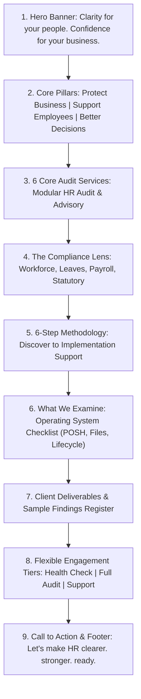

# 📋 Master Transformation Plan: Geniebag Solutions

> **Brand Identity**: Geniebag Solutions / Genie Bag HR Consultancy  
> **Tagline**: *"The Management Basket"*  
> **Brand Promise**: *"Clarity for your people. Confidence for your business."*  
> **Source Material**: [`Docs/Genie_Bag_HR_Compliance_Audit.pptx`](file:///f:/1.Vishal_Gami_Project/geni-bag%202.0/bixoo/Docs/Genie_Bag_HR_Compliance_Audit.pptx) & [`Logo.jpeg`](file:///f:/1.Vishal_Gami_Project/geni-bag%202.0/bixoo/Logo.jpeg)  
> **Target Directory**: [`F:\1.Vishal_Gami_Project\geni-bag 2.0\bixoo`](file:///f:/1.Vishal_Gami_Project/geni-bag%202.0/bixoo)

---

## 🎨 Phase 1: Brand Theme & Color System Overhaul

### 1.1 Palette Alignment
Replace the generic template teal palette in `assets/css/main.css` with the official Geniebag brand colors extracted from the logo and presentation:

| Token | Hex Code | Visual Role |
| :--- | :--- | :--- |
| `--theme` | `#EF6939` | **Geniebag Vibrant Orange** (Primary CTAs, Buttons, Active States, Key Highlights) |
| `--theme-hover` | `#CF4B23` | **Deep Terracotta** (Hover effects, focused states) |
| `--header` / `--bg-3` | `#111B34` | **Executive Midnight Navy** (Navbar background, dark cards, footer background) |
| `--accent-teal` | `#0D9787` | **Trust Mint / Teal** (Audit checkmarks, compliance indicators, badge icons) |
| `--text` | `#526075` | **Professional Slate Navy** (Readable body copy) |
| `--bg-warm` | `#FFEFE4` | **Soft Warm Peach** (Snapshot feature cards, testimonial backgrounds) |
| `--bg-light` | `#F8FAFF` | **Crisp Ice White** (Clean page section background) |
| `--border` | `#E1E9F5` | **Subtle Slate Border** (Clean dividers, card outlines) |

### 1.2 Global Typography & Favicon
- Update favicon link across all pages to use the branded bag/star symbol.
- Standardize font hierarchy using existing high-quality modern sans fonts (*DM Sans* & *Mona Sans*).

---

## 🏗️ Phase 2: Information Architecture & Navigation Cleanup

### 2.1 Navigation Simplification
The stock template contains 12 demo homepages and dummy pages. Simplify the header navbar to a clean, focused corporate structure:
- **Home** (`index.html`)
- **About Us** (`about.html` - Who we are, leadership, why Genie Bag)
- **Services** (`service.html` - 6 Core HR audit modules)
  - HR Compliance Review
  - HR Process Audit
  - Policy & Documentation
  - Employee Records Audit
  - Compensation & Benefits Review
  - Action Plan & Advisory
- **Methodology & Scope** (`#methodology` / anchor on homepage or dedicated page)
- **FAQ** (`faq.html` - Compliance boundaries, engagement models)
- **Contact Us** (`contact.html`)
- **Header Action Button**: `Book an HR Audit` (pointing to `#contact` or `contact.html`)

---

## 📄 Phase 3: Homepage (`index.html`) Transformation

### 3.1 Detailed Section Mapping:
1. **Hero Banner**:
   - Headline: *"Clarity for your people. Confidence for your business."*
   - Subtitle: *"We help organisations turn people processes into clear, consistent and review-ready HR practices."*
   - CTA Buttons: `Schedule a Consultation` | `Explore Audit Scope`
2. **The Big Picture (3 Pillars)**:
   - **Protect the Business**: Spot process gaps early, clarify responsibilities, and maintain compliance discipline.
   - **Support Employees**: Fair, transparent processes for policies, communication, records, and employee concerns.
   - **Enable Better Decisions**: Practical view of risks and priorities for leadership—not just a stack of documents.
3. **What We Do (6 Modular Services)**:
   - Cards with icons, concise descriptions, and links to service details.
4. **Our Method (6-Step Structured Workflow)**:
   - `01 DISCOVER` ➔ `02 COLLECT` ➔ `03 REVIEW` ➔ `04 PRIORITISE` ➔ `05 REPORT` ➔ `06 SUPPORT`.
5. **What We Examine (The HR Operating System)**:
   - People Files | Joining to Exit | Time & Pay Inputs | Policies & Culture (POSH) | Statutory Readiness | Governance & Controls.
6. **Sample Findings & Deliverables Showcase**:
   - Executive Summary, Compliance Checklist, Findings Register with Risk Prioritization (High / Medium / Low), Corrective Action Tracker.
7. **Flexible Engagement Tiers**:
   - *Focused Health Check* (Targeted review of specific policies/records)
   - *Comprehensive Audit* (Full workforce, statutory, and process review)
   - *Implementation Support* (Hands-on corrective action tracking and policy rollout)
8. **Statutory Disclaimer**:
   - Clear note emphasizing consultancy readiness support vs. legal counsel.

---

## 📑 Phase 4: Supporting Pages Content Refresh

### 4.1 About Us (`about.html`)
- **Our Story & Approach**: Blending rigorous structure with practical day-to-day HR realities.
- **Why Genie Bag**:
  - Independent view of HR processes
  - Clearer documentation & accountability
  - Visibility into compliance gaps before they grow
  - Prioritised actions instead of overwhelm
  - Confidential, respectful engagement

### 4.2 Services (`service.html` & `service-details.html`)
- Dedicated breakdown of all 6 service modules with deliverables and scope boundaries.

### 4.3 FAQ Page (`faq.html`)
- *"What documents are reviewed during the audit?"*
- *"How long does a standard HR compliance audit take?"*
- *"How do you handle confidentiality of payroll and personnel data?"*
- *"What is the difference between a health check and a full audit?"*

### 4.4 Contact Page (`contact.html`)
- Inquiry form with specific fields: Organization size, primary concerns (Statutory, Policies, Records, POSH), and preferred engagement model.
- Location and communication details.

---

## 🚀 Phase 5: Testing, Git Staging & Deployment

1. **Cross-Device Responsive Verification**:
   - Test navigation bar, hero banner, cards, and tables on Desktop, Tablet, and Mobile.
2. **Git Version Control**:
   - Commit phase-by-phase updates cleanly to Git with descriptive messages.
3. **Deployment**:
   - Connect to remote repository (GitHub / GitLab) and verify production preview.
